# Mainframe Modernization with AI Agents

[🇧🇷 Português](README.md) | 🇺🇸 English

[](https://github.com/valentinJunior/Modernizacao-Mainframe/actions/workflows/ci-cd.yml)

A capstone that walks through, at teaching scale, the three stages of a modernization supported by AI agents. The system is the daily interest accrual for credit contracts (job `JURD0100`):

1. **Inventory:** `inventario_mainframe.py` reads the JCL, COBOL and copybook sources and produces a structured inventory. A deterministic parser extracts the facts; a local model running on Ollama interprets business rules and risks, so no source code ever leaves the machine.
2. **Documentation:** business rules, rejection codes, a worked numerical example and risks, all produced from the inventory.
3. **Conversion of the calculation rule:** `servico-juros/`, a Java microservice equivalent to the COBOL subroutine `JURS0100`. Equivalence is checked in CI against the original `JURS0100` compiled with GnuCOBOL; the next step is to validate it against real mainframe data.

## Scope and limitations

> **The legacy system is synthetic and small.** "Banco Exemplo" was written for this demonstration: 1 JCL job, 2 COBOL programs totaling 652 lines and 5 copybooks, 985 lines in all. There is no CICS, VSAM, online DB2 or cataloged PROCs, and nothing close to the thousands of programs of a real mainframe. The goal is to show the **method**, not to claim it has already been applied to a production system.

- **Only the calculation rule was converted.** What became a service is the `JURS0100` subroutine and the rate lookup from `JURB0100`. The DB2 unload, the sorts, the branch-and-product summary for accounting, the GDG-based reprocessing control and the daily accrual of the portfolio all remain on the mainframe, unchanged. The batch endpoint (up to 1,000 contracts) is for simulation and reconciliation; it does not replace the nightly batch job.
- **GnuCOBOL is not z/OS Enterprise COBOL.** Fractional exponentiation (`**`) and the intermediate precision of `COMPUTE` may produce different results on the mainframe. That is why equivalence is demonstrated against COBOL compiled with GnuCOBOL; it is not proven for production. Details in [`equivalencia-cobol/README.en.md`](equivalencia-cobol/README.en.md).
- **The equivalence dataset has 27 cases** covering edge cases, rounding and rejections. It does not yet include real data extracted from a `JURD0100` run.

## Why the code is in Portuguese

The legacy system represents a Brazilian bank, so its COBOL programs, copybooks and datasets use Portuguese names. The Java names deliberately mirror the COBOL names to keep every piece traceable back to the legacy: translating them would weaken the equivalence evidence, which relies on a one-to-one mapping between COBOL paragraphs and Java methods. API messages and rejection codes are kept in Portuguese because they are part of the API contract.

| Portuguese | English |
| --- | --- |
| `CalculadoraEncargos` | charges calculator |
| encargos | charges |
| juros remuneratórios | contractual interest |
| juros de mora | late-payment interest |
| multa | late fee |
| saldo devedor | outstanding balance |
| taxa | rate |
| spread por rating | rating spread |
| vigência | validity period |
| rejeição | rejection |
| massa de equivalência | equivalence dataset |

## How AI was used

The project followed **spec-driven development**. The analyst wrote the specs ([`spec.en.md`](spec.en.md) and [`spec-microservico-java.en.md`](spec-microservico-java.en.md)), with the sources of truth, the constraints and the acceptance criteria. An AI coding agent (Claude, via Claude Code) implemented from them. Human review decided what got in.

| Stage | Human role | AI role |
| --- | --- | --- |
| Inventory | Specified the two layers (facts vs. interpretation) and the acceptance criteria | The agent implemented the parser; a local LLM (`qwen2.5:7b` on Ollama) interprets rules and risks |
| Conversion | Established that the COBOL takes precedence over the documentation and that any divergence is a business decision | The agent implemented the service, the tests and the equivalence dataset |
| Validation | Asked whether the project was ready to present to bank executives; the answer exposed that equivalence had never actually been run against the COBOL | The agent set up execution of the original `JURS0100` with GnuCOBOL, plus the CI/CD |
| External review | A human reviewer found a denial-of-service flaw (balance in scientific notation), questioned the silent truncation of the balance and flagged sentences that promised more than the project delivers | The agent reproduced and fixed the flaw, turned the attacks into 15 tests and revised the wording |

Takeaways from this experience:
- **AI sped up implementation, but did not replace review.** The first version of the service passed all 53 original tests and still had a security flaw, because no test exercised hostile input. Details in [`servico-juros/DECISOES.en.md`](servico-juros/DECISOES.en.md), D12.
- **Mutation testing measures test quality.** Swapping `HALF_UP` for `HALF_EVEN` showed that the first equivalence dataset had no half-cent tie cases at all. Those cases were added afterwards (D11).
- **Divergences are recorded, not silently fixed.** Every difference from the legacy behavior is listed in [`servico-juros/DIVERGENCIAS.en.md`](servico-juros/DIVERGENCIAS.en.md), with the history of the decision.

## Presentation

The 13 slides are shown below as images. The PDF is at [`docs/presentation.pdf`](docs/presentation.pdf). If GitHub's viewer does not open it, use the [direct download](https://raw.githubusercontent.com/valentinJunior/Modernizacao-Mainframe/main/docs/presentation.pdf).

<details open>
<summary><b>View the slides</b></summary>

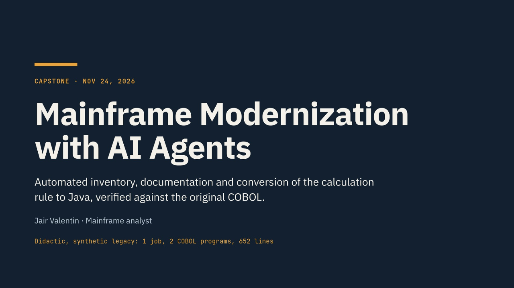
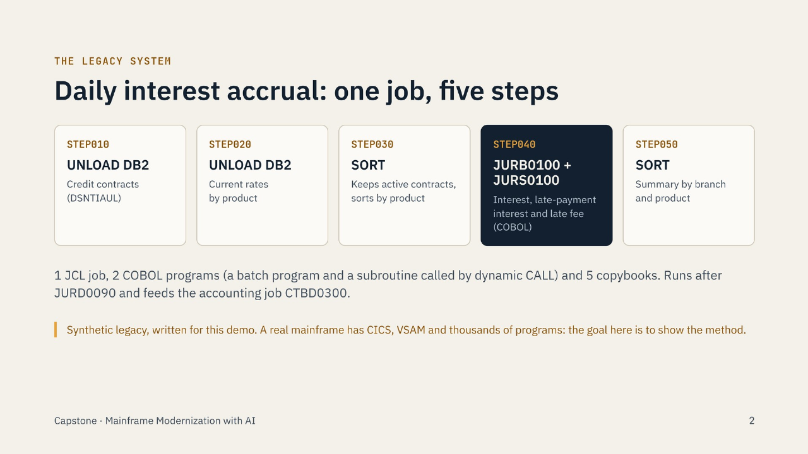
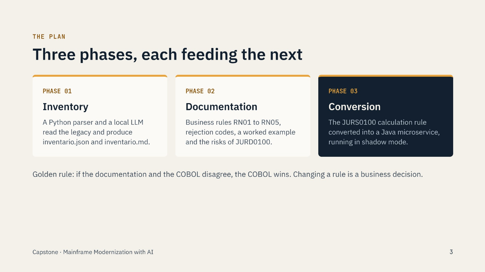
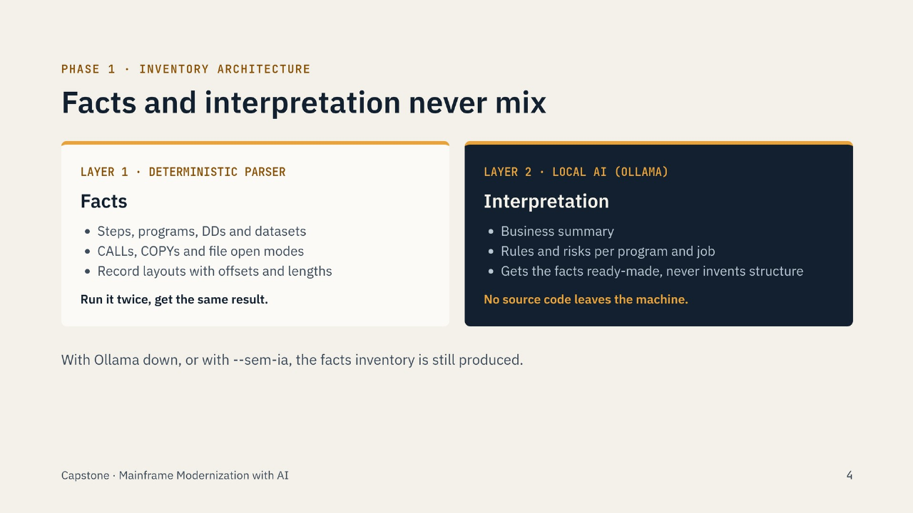
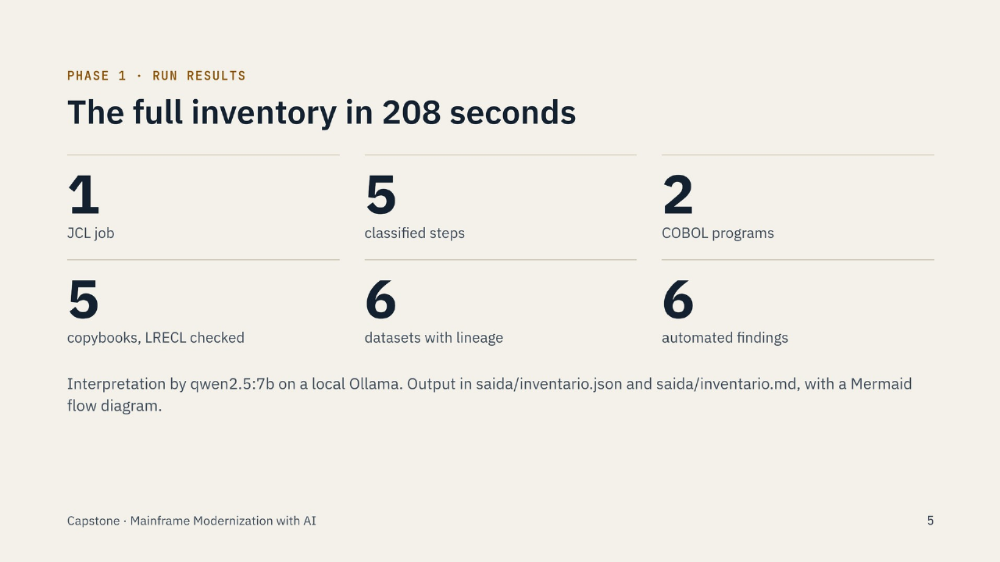
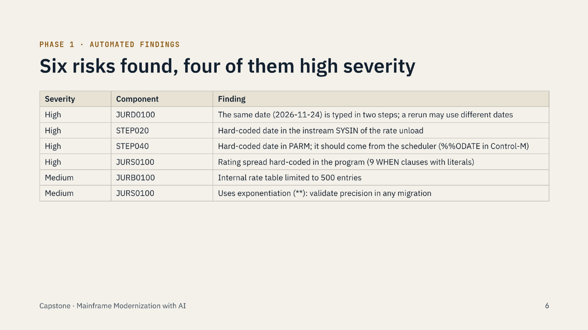
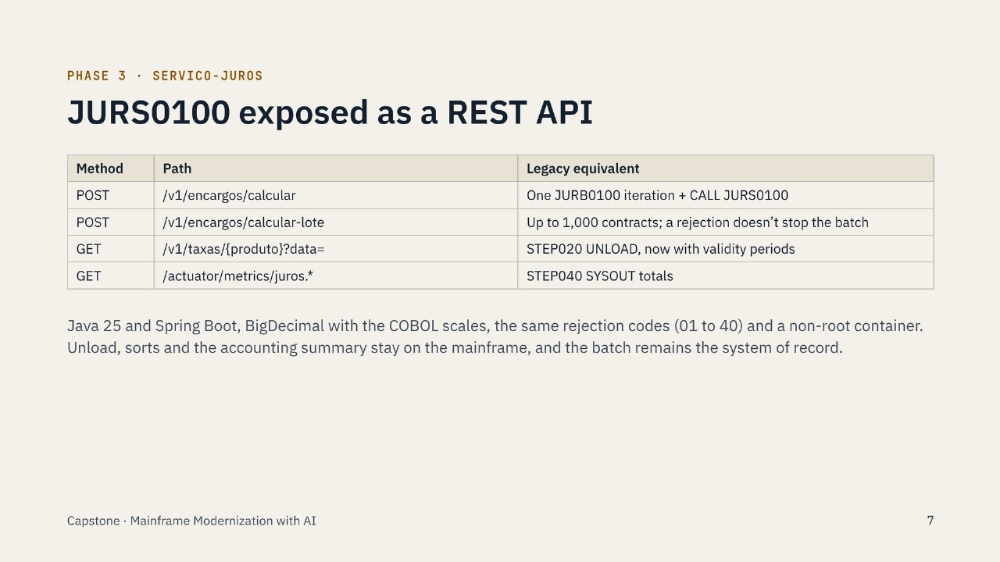
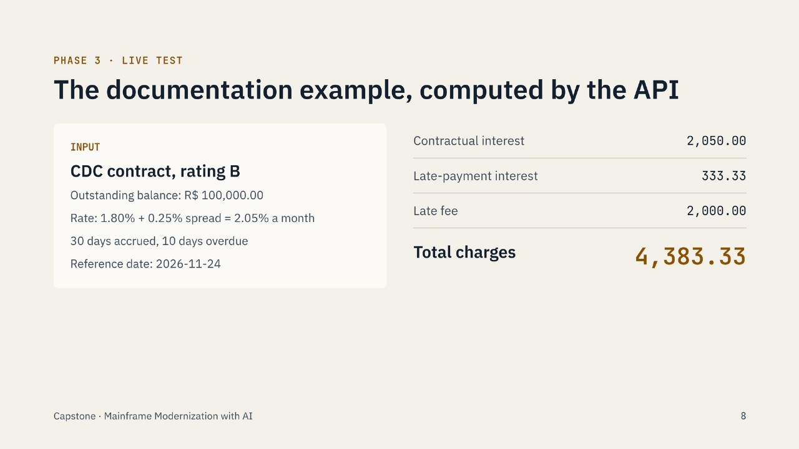
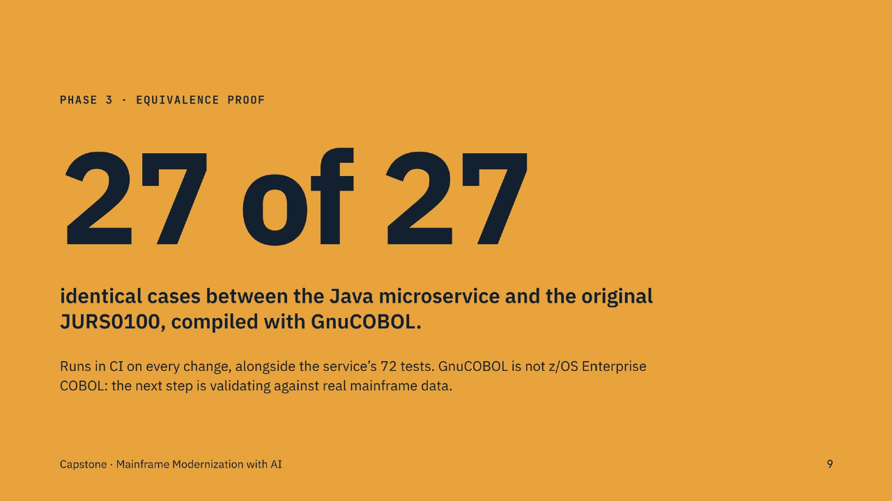
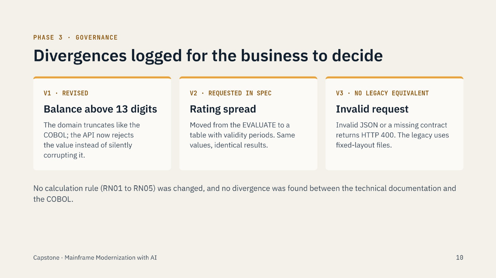
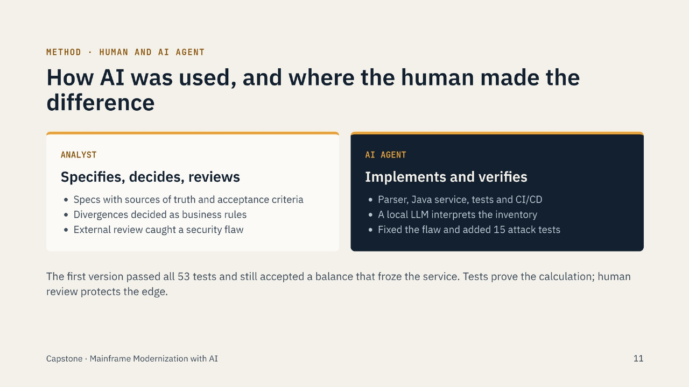
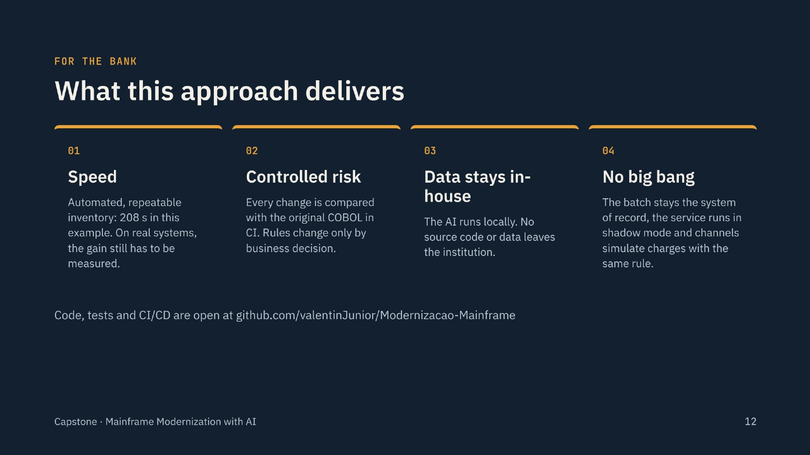
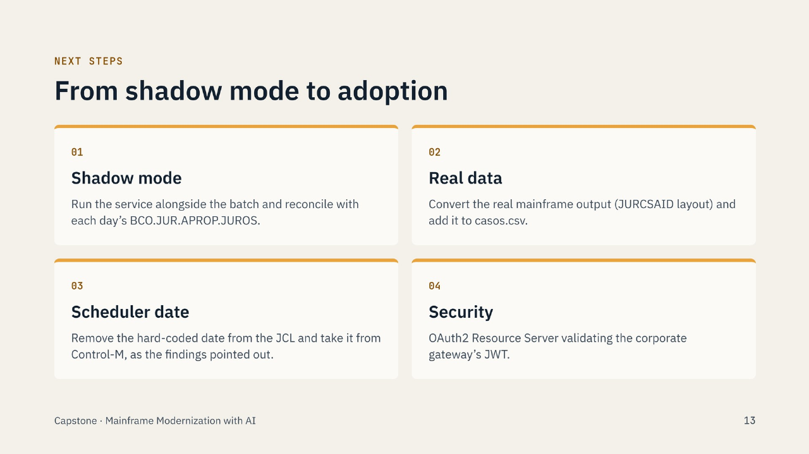

</details>

## Structure

| Path | Contents |
| --- | --- |
| `legado/` | Mainframe system sources: JCL, COBOL and copybooks |
| `inventario_mainframe.py` | Inventory generator (phase 1) |
| `saida/` | Generated inventory, in JSON and Markdown |
| `servico-juros/` | Java microservice (phase 3), with its own README |
| `equivalencia-cobol/` | Runs the original JURS0100 with GnuCOBOL and compares it with the Java |
| `spec.md`, `spec-microservico-java.md` | Specifications for phases 1 and 3 (English: `spec.en.md`, `spec-microservico-java.en.md`) |
| `docs/` | Presentation slides, as PDF and as images (`docs/slides/` in Portuguese, `docs/slides-en/` in English) |

## How to run

**Inventory** (Python 3, Ollama optional):

```bash
python3 inventario_mainframe.py            # with local AI (qwen2.5:7b on Ollama)
python3 inventario_mainframe.py --sem-ia   # facts only
```

**Microservice, from the published image** (the fastest way; no need to download the code):

```bash
podman run --rm -p 8080:8080 ghcr.io/valentinjunior/servico-juros:latest   # or docker run
```

Then test it with the example from the technical documentation, which should return `"totalEncargos": 4383.33`:

```bash
curl -s -X POST localhost:8080/v1/encargos/calcular -H 'Content-Type: application/json' \
  -d '{"numeroContrato":"000012345678","codigoProduto":"CDC","rating":"B","saldoDevedor":100000.00,
       "dataUltimaApuracao":"2026-10-25","dataVencimento":"2026-11-14","dataReferencia":"2026-11-24"}'
```

**Microservice, building from source** (Podman or Docker; no local JDK required):

```bash
cd servico-juros
podman build -t servico-juros:1.0 .              # compiles and runs the 72 tests
podman run --rm -p 8080:8080 servico-juros:1.0   # API on localhost:8080
```

Sample requests are in `servico-juros/requisicoes.http`, and the API documentation is at `http://localhost:8080/swagger-ui.html`.

## CI/CD

Every push and pull request runs three checks on GitHub Actions (`.github/workflows/ci-cd.yml`):

| Job | What it guarantees |
| --- | --- |
| Inventory | The parser generates the facts inventory without errors. The AI stays out of CI, since it only runs on local Ollama |
| Microservice | Build plus the 72 tests of `servico-juros`, including equivalence |
| COBOL vs. Java equivalence | The original `JURS0100`, compiled with GnuCOBOL, produces exactly the result the Java expects |

On `main`, if all three pass, the service image is published to [`ghcr.io/valentinjunior/servico-juros`](https://github.com/valentinJunior/Modernizacao-Mainframe/pkgs/container/servico-juros), tagged `latest` and with the commit hash. The image is public, so anyone can run exactly the version that passed the equivalence tests.

## Results

- Inventory: 1 job, 5 steps, 2 programs, 5 copybooks, 6 datasets and 6 automated findings.
- Microservice: 72 tests passing, including 27 equivalence tests and 15 hostile-input tests.
- Equivalence: the original `JURS0100`, compiled with GnuCOBOL, produces the same results as the Java in all 27 cases, across every field (`./equivalencia-cobol/executar.sh`). Validation against a real mainframe run is still pending.
- Technical documentation example: an outstanding balance of R$ 100,000.00 generates R$ 4,383.33 in charges, the same amount as in the documentation.
