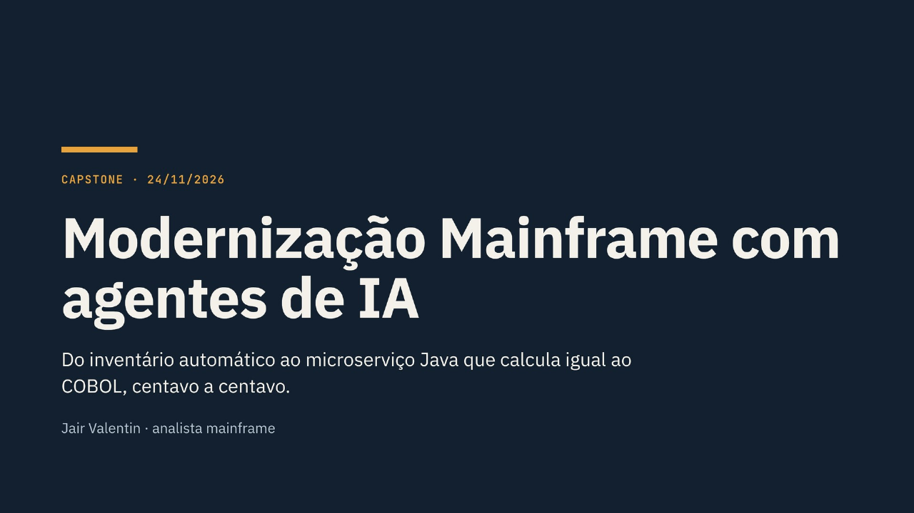
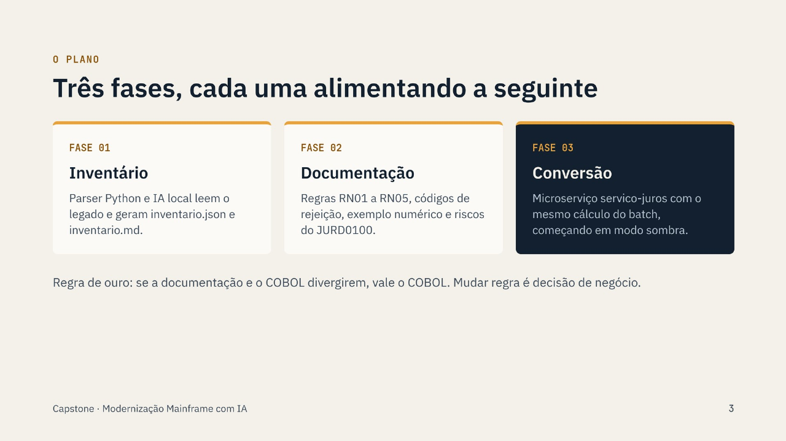
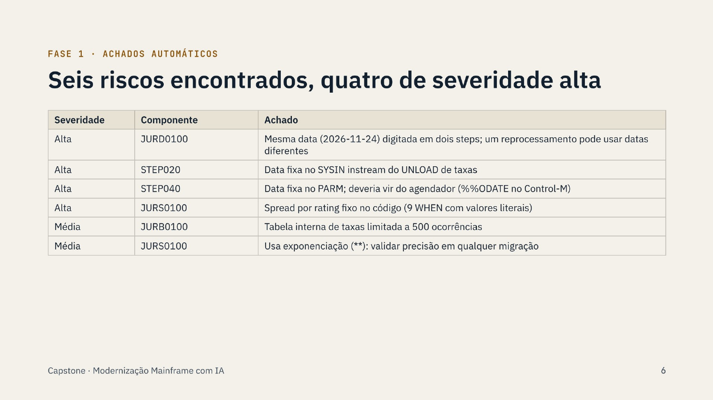
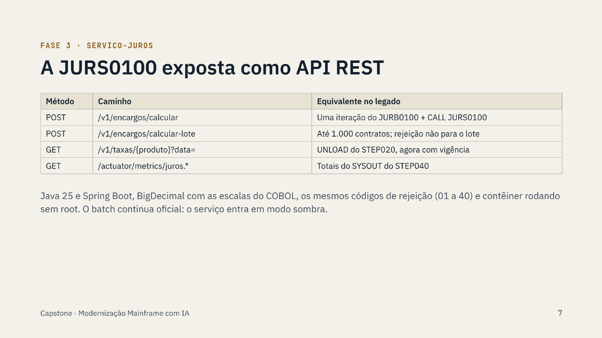
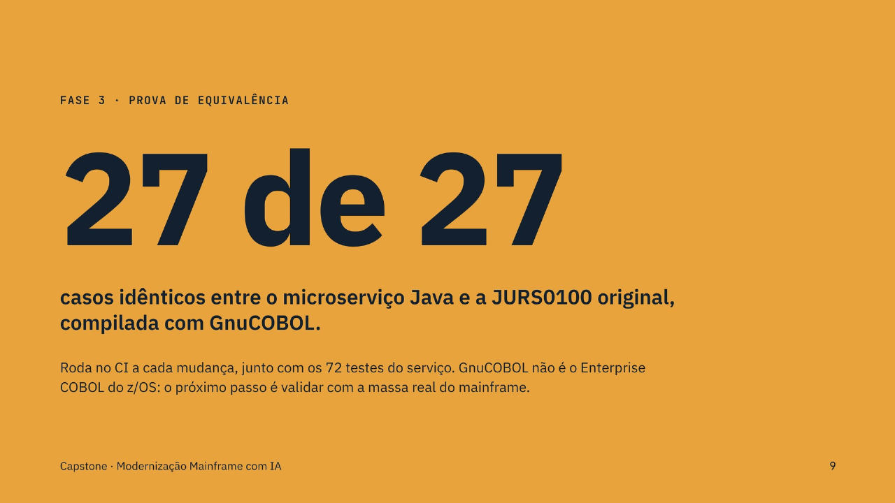
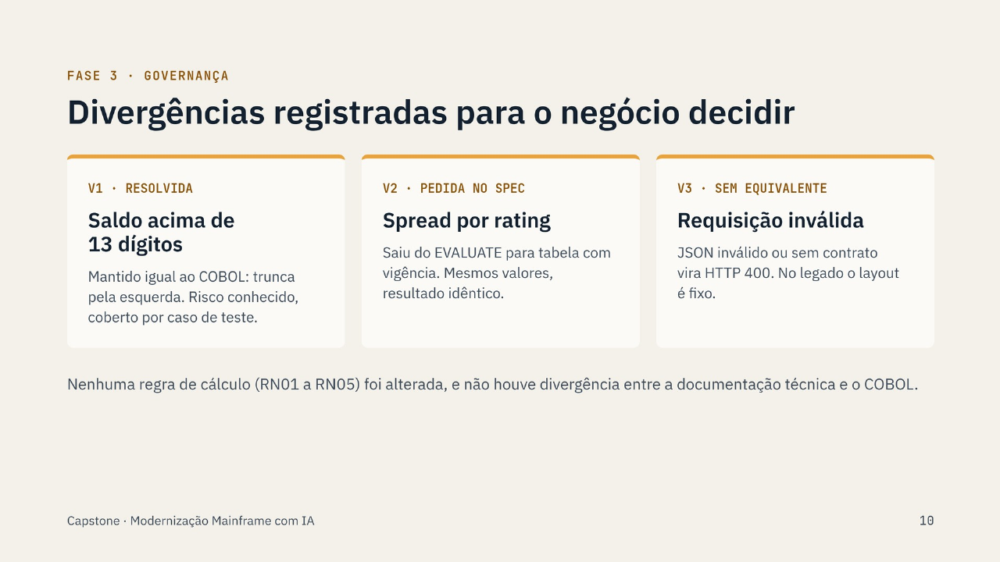

# Modernização Mainframe com agentes de IA

[](https://github.com/valentinJunior/Modernizacao-Mainframe/actions/workflows/ci-cd.yml)

Capstone que percorre o ciclo completo de modernização de um sistema bancário de exemplo, a apropriação diária de juros de contratos de crédito (job `JURD0100`):

1. **Inventário:** `inventario_mainframe.py` lê os fontes JCL, COBOL e copybooks e gera um inventário estruturado. Um parser determinístico extrai os fatos; um modelo local no Ollama interpreta regras e riscos, sem que nenhum fonte saia da máquina.
2. **Documentação:** regras de negócio, códigos de rejeição, exemplo numérico e riscos, produzidos a partir do inventário.
3. **Conversão:** `servico-juros/`, microserviço Java com o mesmo cálculo da sub-rotina COBOL `JURS0100`, provado por testes de equivalência centavo a centavo.

## Apresentação

Os 12 slides estão logo abaixo, como imagens. O PDF fica em [`docs/apresentacao.pdf`](docs/apresentacao.pdf). Se o visualizador do GitHub não abrir, use o [download direto](https://raw.githubusercontent.com/valentinJunior/Modernizacao-Mainframe/main/docs/apresentacao.pdf).

<details open>
<summary><b>Ver os slides</b></summary>













</details>

## Estrutura

| Caminho | Conteúdo |
| --- | --- |
| `legado/` | Fontes do sistema mainframe: JCL, COBOL e copybooks |
| `inventario_mainframe.py` | Gerador do inventário (fase 1) |
| `saida/` | Inventário gerado, em JSON e Markdown |
| `servico-juros/` | Microserviço Java (fase 3), com README próprio |
| `equivalencia-cobol/` | Executa a JURS0100 original com GnuCOBOL e compara com o Java |
| `spec.md`, `spec-microservico-java.md` | Especificações das fases 1 e 3 |
| `docs/` | Slides da apresentação, em PDF e em imagens (`docs/slides/`) |

## Como executar

**Inventário** (Python 3, Ollama opcional):

```bash
python3 inventario_mainframe.py            # com IA local (qwen2.5:7b no Ollama)
python3 inventario_mainframe.py --sem-ia   # só os fatos
```

**Microserviço** (Podman ou Docker; não precisa de JDK local):

```bash
cd servico-juros
podman build -t servico-juros:1.0 .              # compila e roda os 53 testes
podman run --rm -p 8080:8080 servico-juros:1.0   # API em localhost:8080
```

Exemplos de chamadas em `servico-juros/requisicoes.http` e documentação da API em `http://localhost:8080/swagger-ui.html`.

## CI/CD

Todo push e pull request roda três verificações no GitHub Actions (`.github/workflows/ci-cd.yml`):

| Job | O que garante |
| --- | --- |
| Inventário | O parser gera o inventário de fatos sem erro. A IA fica fora do CI, porque roda só no Ollama local |
| Microserviço | Build e os 53 testes do `servico-juros`, inclusive a equivalência |
| Equivalência COBOL x Java | A `JURS0100` original, compilada com GnuCOBOL, produz exatamente o resultado esperado pelo Java |

Na `main`, se as três passarem, a imagem do serviço é publicada em `ghcr.io/valentinjunior/servico-juros`, com as tags `latest` e o hash do commit.

## Resultados

- Inventário: 1 job, 5 steps, 2 programas, 5 copybooks, 6 datasets e 6 achados automáticos.
- Microserviço: 53 testes passando, 27 deles de equivalência com o COBOL.
- COBOL real: a `JURS0100` original, compilada com GnuCOBOL, produz exatamente os mesmos resultados nos 27 casos (`./equivalencia-cobol/executar.sh`).
- Exemplo da documentação técnica: R$ 100.000,00 de saldo gera R$ 4.383,33 de encargos, igual ao batch.
