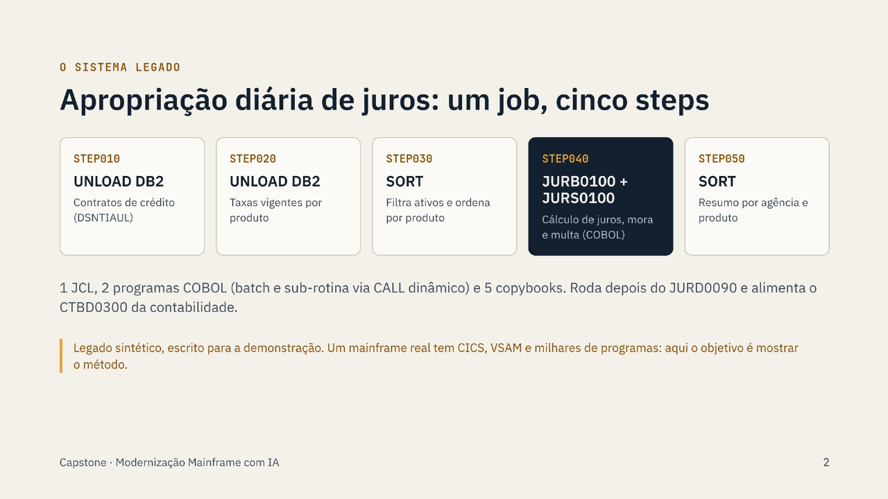
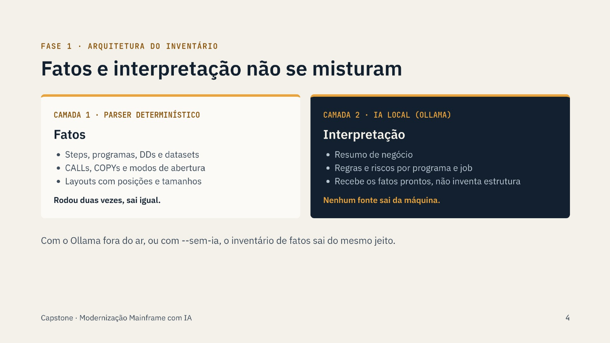
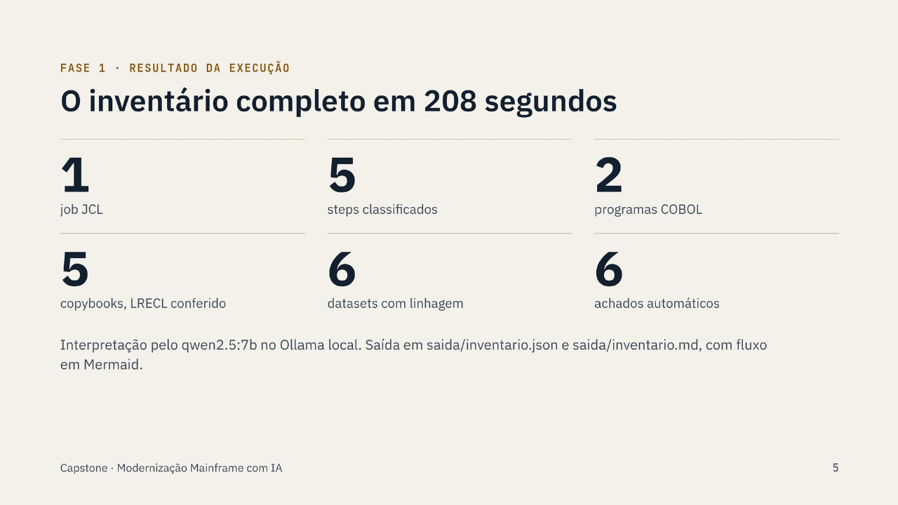
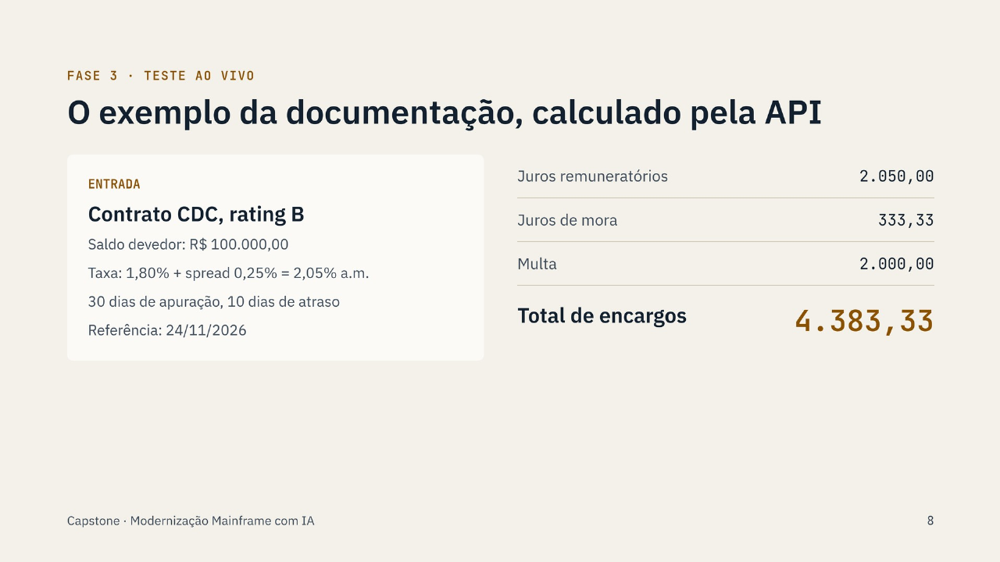
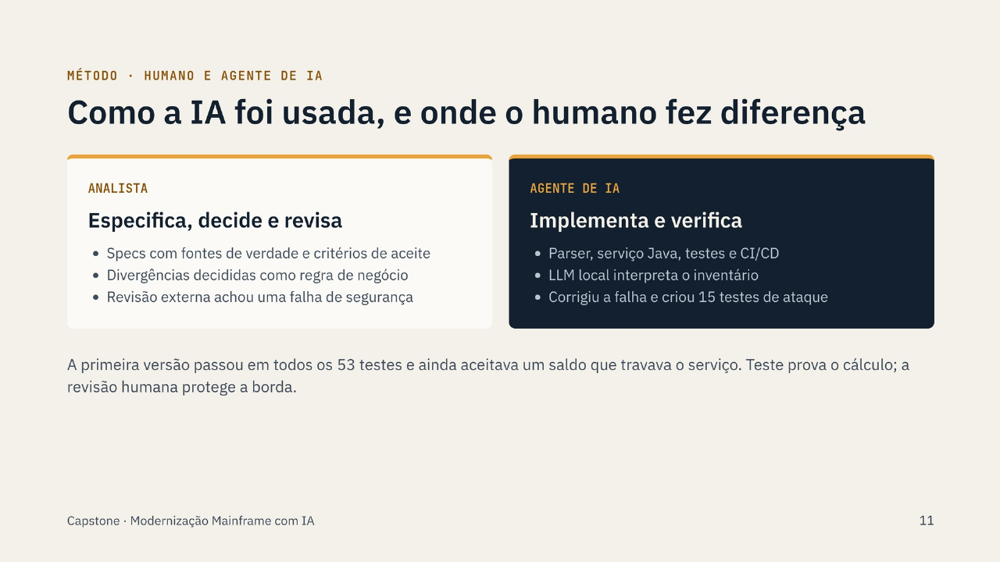
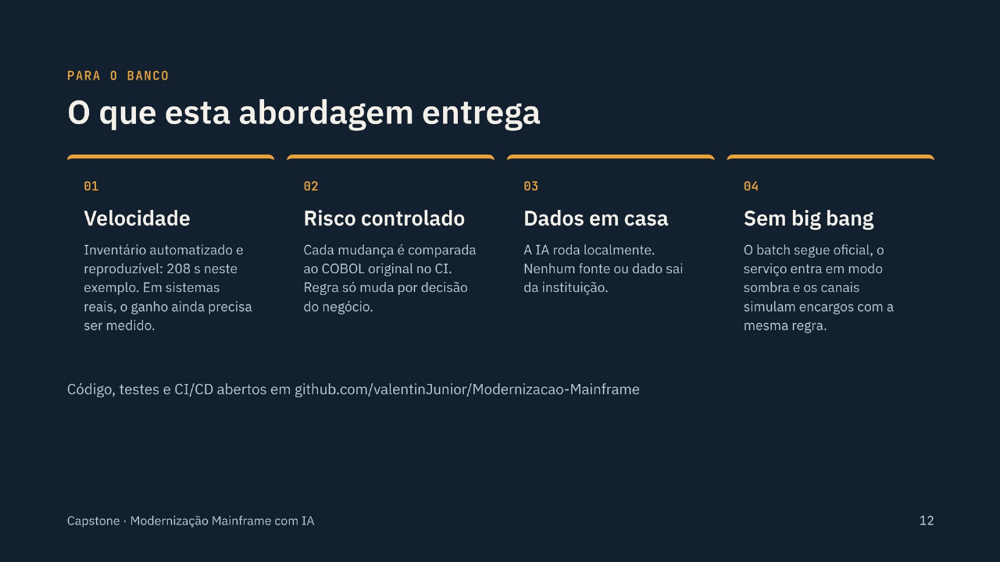

# Modernização Mainframe com agentes de IA

[](https://github.com/valentinJunior/Modernizacao-Mainframe/actions/workflows/ci-cd.yml)

Capstone que percorre, em escala didática, as três etapas de uma modernização com apoio de agentes de IA. O sistema é a apropriação diária de juros de contratos de crédito (job `JURD0100`):

1. **Inventário:** `inventario_mainframe.py` lê os fontes JCL, COBOL e copybooks e gera um inventário estruturado. Um parser determinístico extrai os fatos; um modelo local no Ollama interpreta regras e riscos, sem que nenhum fonte saia da máquina.
2. **Documentação:** regras de negócio, códigos de rejeição, exemplo numérico e riscos, produzidos a partir do inventário.
3. **Conversão da regra de cálculo:** `servico-juros/`, microserviço Java equivalente à sub-rotina COBOL `JURS0100`. A equivalência é verificada no CI contra a `JURS0100` original compilada com GnuCOBOL; o próximo passo é validar com a massa real do mainframe.

## Escopo e limitações

> **O legado é sintético e pequeno.** O "Banco Exemplo" foi escrito para esta demonstração: 1 job JCL, 2 programas COBOL com 652 linhas e 5 copybooks, 985 linhas no total. Não há CICS, VSAM, DB2 online, PROCs catalogadas nem a escala de milhares de programas de um mainframe real. O objetivo é mostrar o **método**, não afirmar que ele já foi aplicado a um sistema de produção.

- **Só a regra de cálculo foi convertida.** O que virou serviço é a sub-rotina `JURS0100` e a busca de taxa do `JURB0100`. Continuam no mainframe, sem alteração, o unload do DB2, os sorts, o resumo por agência e produto para a contabilidade, o controle de reprocessamento via GDG e a apropriação diária da carteira. O endpoint de lote (até 1.000 contratos) serve para simulação e conciliação; não substitui o batch.
- **GnuCOBOL não é o Enterprise COBOL do z/OS.** A potência fracionária (`**`) e a precisão intermediária do `COMPUTE` podem dar resultados diferentes no mainframe. Por isso a equivalência está demonstrada contra o COBOL compilado com GnuCOBOL; ela não está provada para a produção. Detalhes em [`equivalencia-cobol/README.md`](equivalencia-cobol/README.md).
- **A massa de equivalência tem 27 casos** de borda, de arredondamento e de rejeição. Ainda não inclui uma massa real extraída da execução do `JURD0100`.

## Como a IA foi usada

O projeto seguiu **desenvolvimento guiado por especificação**. O analista escreveu as specs ([`spec.md`](spec.md) e [`spec-microservico-java.md`](spec-microservico-java.md)), com as fontes de verdade, as restrições e os critérios de aceite. Um agente de IA de desenvolvimento (Claude, via Claude Code) implementou a partir delas. A revisão humana decidiu o que entrava.

| Etapa | Papel humano | Papel da IA |
| --- | --- | --- |
| Inventário | Especificou as duas camadas (fatos × interpretação) e os critérios de aceite | O agente implementou o parser; um LLM local (`qwen2.5:7b` no Ollama) interpreta regras e riscos |
| Conversão | Definiu que o COBOL prevalece sobre a documentação e que divergência é decisão de negócio | O agente implementou o serviço, os testes e a massa de equivalência |
| Validação | Perguntou se o projeto estava pronto para executivos; a resposta expôs que a equivalência nunca tinha sido executada contra o COBOL | O agente montou a execução da `JURS0100` original com GnuCOBOL e o CI/CD |
| Revisão externa | Um revisor humano encontrou uma falha de negação de serviço (saldo em notação científica), questionou o truncamento silencioso do saldo e apontou frases que prometiam mais do que o projeto entrega | O agente reproduziu e corrigiu a falha, transformou os ataques em 15 testes e ajustou os textos |

O que fica dessa experiência:
- **A IA acelerou a implementação, mas não substituiu a revisão.** A primeira versão do serviço passou em todos os 53 testes originais e ainda assim tinha uma falha de segurança, porque nenhum teste explorava entrada hostil. Os detalhes estão em [`servico-juros/DECISOES.md`](servico-juros/DECISOES.md), D12.
- **Teste de mutação mede a qualidade dos testes.** Trocar `HALF_UP` por `HALF_EVEN` mostrou que a primeira massa de equivalência não tinha nenhum caso de empate de meio centavo. Os casos foram incluídos depois (D11).
- **Divergências ficam registradas, não corrigidas em silêncio.** Cada diferença em relação ao legado está em [`servico-juros/DIVERGENCIAS.md`](servico-juros/DIVERGENCIAS.md), com o histórico da decisão.

## Apresentação

Os 13 slides estão logo abaixo, como imagens. O PDF fica em [`docs/apresentacao.pdf`](docs/apresentacao.pdf). Se o visualizador do GitHub não abrir, use o [download direto](https://raw.githubusercontent.com/valentinJunior/Modernizacao-Mainframe/main/docs/apresentacao.pdf).

<details open>
<summary><b>Ver os slides</b></summary>















</details>

## Estrutura

| Caminho | Conteúdo |
| --- | --- |
| `legado/` | Fontes do sistema mainframe: JCL, COBOL e copybooks |
| `inventario_mainframe.py` | Gerador do inventário (fase 1) |
| `saida/` | Inventário gerado, em JSON e Markdown |
| `servico-juros/` | Microserviço Java (fase 3), com README próprio |
| `equivalencia-cobol/` | Executa a JURS0100 original com GnuCOBOL e compara com o Java |
| `spec.md`, `spec-microservico-java.md` | Especificações das fases 1 e 3 |
| `docs/` | Slides da apresentação, em PDF e em imagens (`docs/slides/`) |

## Como executar

**Inventário** (Python 3, Ollama opcional):

```bash
python3 inventario_mainframe.py            # com IA local (qwen2.5:7b no Ollama)
python3 inventario_mainframe.py --sem-ia   # só os fatos
```

**Microserviço, pela imagem publicada** (o jeito mais rápido; não precisa baixar o código):

```bash
podman run --rm -p 8080:8080 ghcr.io/valentinjunior/servico-juros:latest   # ou docker run
```

Depois, teste com o exemplo da documentação técnica, que deve retornar `"totalEncargos": 4383.33`:

```bash
curl -s -X POST localhost:8080/v1/encargos/calcular -H 'Content-Type: application/json' \
  -d '{"numeroContrato":"000012345678","codigoProduto":"CDC","rating":"B","saldoDevedor":100000.00,
       "dataUltimaApuracao":"2026-10-25","dataVencimento":"2026-11-14","dataReferencia":"2026-11-24"}'
```

**Microserviço, compilando a partir do código** (Podman ou Docker; não precisa de JDK local):

```bash
cd servico-juros
podman build -t servico-juros:1.0 .              # compila e roda os 72 testes
podman run --rm -p 8080:8080 servico-juros:1.0   # API em localhost:8080
```

Exemplos de chamadas em `servico-juros/requisicoes.http` e documentação da API em `http://localhost:8080/swagger-ui.html`.

## CI/CD

Todo push e pull request roda três verificações no GitHub Actions (`.github/workflows/ci-cd.yml`):

| Job | O que garante |
| --- | --- |
| Inventário | O parser gera o inventário de fatos sem erro. A IA fica fora do CI, porque roda só no Ollama local |
| Microserviço | Build e os 72 testes do `servico-juros`, inclusive a equivalência |
| Equivalência COBOL x Java | A `JURS0100` original, compilada com GnuCOBOL, produz exatamente o resultado esperado pelo Java |

Na `main`, se as três passarem, a imagem do serviço é publicada em [`ghcr.io/valentinjunior/servico-juros`](https://github.com/valentinJunior/Modernizacao-Mainframe/pkgs/container/servico-juros), com as tags `latest` e o hash do commit. A imagem é pública, então qualquer pessoa consegue executar exatamente a versão que passou nos testes de equivalência.

## Resultados

- Inventário: 1 job, 5 steps, 2 programas, 5 copybooks, 6 datasets e 6 achados automáticos.
- Microserviço: 72 testes passando, sendo 27 de equivalência e 15 de entrada hostil.
- Equivalência: a `JURS0100` original, compilada com GnuCOBOL, produz os mesmos resultados do Java nos 27 casos, em todos os campos (`./equivalencia-cobol/executar.sh`). Ainda falta validar contra a execução real no mainframe.
- Exemplo da documentação técnica: R$ 100.000,00 de saldo gera R$ 4.383,33 de encargos, o mesmo valor da documentação.
