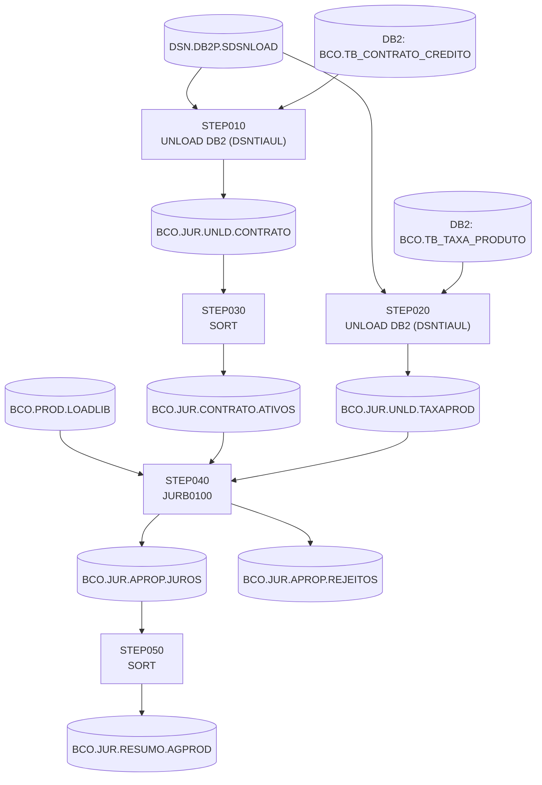

# Inventario de componentes mainframe

Gerado em 2026-11-25 09:16:31 a partir de `legado` (inventario_mainframe.py v1.0). Interpretacao por IA local: `qwen2.5:7b`.

## Visao geral

| Jobs | Steps | Programas | Copybooks | Datasets | Achados |
| --- | --- | --- | --- | --- | --- |
| 1 | 5 | 2 | 5 | 6 | 6 |

## Job JURD0100 — APROP JUROS DIARIA

- **Objetivo:** APURAR DIARIAMENTE OS JUROS REMUNERATORIOS, JUROS DE MORA E MULTA DOS CONTRATOS DE CREDITO ATIVOS E GERAR O RESUMO POR AGENCIA/PRODUTO PARA A CONTABILIDADE.
- **Periodicidade:** DIARIA - APOS O FECHAMENTO DO MOVIMENTO (CONTROL-M)
- **Predecessor:** JURD0090 (ATUALIZACAO DE SALDOS DO DIA)
- **Sucessor:** CTBD0300 (LANCAMENTOS CONTABEIS DE RENDAS DE CREDITO)
- **Fonte:** `legado/jcl/JURD0100.jcl`

**Interpretacao gerada por IA (qwen2.5:7b) — validar com o analista**

- **Para o negocio:** Este processo diário calcula e atribui juros, multas e juros de mora aos contratos de crédito ativos, gerando um resumo por agência/produto para a contabilidade.
- **Funcao tecnica:** O JCL executa uma sequência de passos que inclui a extração de dados de bancos de dados, processamento de juros e geração de relatórios.
- **Regras de negocio:**
    - Os juros são calculados com base nas taxas vigentes na data de referência.
    - Apenas contratos ativos com saldo devedor positivo são considerados.
    - Os juros remuneratórios, juros de mora e multa são calculados separadamente.
    - O resumo final é gerado por agência e produto, totalizando os encargos.
    - Em caso de erro, os arquivos gerados devem ser deletados e o processo reiniciado.
    - A data de referência é substituída pelo Control-M na produção.
- **Riscos:**
    - A data de referência pode causar problemas se não for atualizada corretamente.
    - Erros no processo de extração de dados podem afetar a precisão dos cálculos.
    - A rejeição de contratos pode gerar arquivos de rejeição que precisam ser monitorados.
    - O processo de geração de relatórios pode falhar se os arquivos de entrada estiverem corrompidos.
    - A reinicialização do processo após um erro pode causar inconsistências se não for feita corretamente.

### Fluxo

### Steps

| Step | Tipo | Programa | PARM | COND | Descricao |
| --- | --- | --- | --- | --- | --- |
| STEP010 | UNLOAD DB2 (DSNTIAUL) | IKJEFT01 |  |  | UNLOAD DB2 DOS CONTRATOS DE CREDITO (DSNTIAUL) |
| STEP020 | UNLOAD DB2 (DSNTIAUL) | IKJEFT01 |  | (4,LT) | UNLOAD DB2 DAS TAXAS VIGENTES POR PRODUTO (DSNTIAUL) |
| STEP030 | SORT | SORT |  | (4,LT) | SORT: FILTRA ATIVOS E ORDENA POR PRODUTO (DFSORT) |
| STEP040 | Programa aplicativo | JURB0100 | 2026-11-24 | (4,LT) | CALCULO DOS JUROS - JURB0100 + JURS0100 (COBOL) |
| STEP050 | SORT | SORT |  | (4,LT) | SORT: RESUMO POR AGENCIA/PRODUTO (DFSORT) |

**STEP010**

- Tabelas DB2: BCO.TB_CONTRATO_CREDITO
- SQL: `SELECT NR_CONTRATO ,CD_AGENCIA ,CD_PRODUTO ,CD_RATING ,VL_SALDO_DEVEDOR ,CHAR(DT_ULT_APURACAO, ISO) ,CHAR(DT_VENCIMENTO, ISO) ,ST_CONTRATO FROM BCO.TB_CONTRATO_CREDITO;`

**STEP020**

- Tabelas DB2: BCO.TB_TAXA_PRODUTO
- SQL: `SELECT CD_PRODUTO ,DS_PRODUTO ,PC_TAXA_MENSAL ,PC_MORA_MENSAL ,PC_MULTA FROM BCO.TB_TAXA_PRODUTO WHERE DT_INI_VIGENCIA <= '2026-11-24' AND DT_FIM_VIGENCIA >= '2026-11-24' ORDER BY CD_PRODUTO;`

**STEP030**

- Filtro: `INCLUDE COND=(50,1,CH,EQ,C'A',AND,22,8,PD,GT,+0)`
- Chaves: pos 17 tam 3 CH ascendente, pos 1 tam 12 CH ascendente
- Reformata registro: nao; gera relatorio: nao

**STEP040**

- DD `CONTRATO` → `BCO.JUR.CONTRATO.ATIVOS` (ARQ-CONTRATO, layout JURCCONT, INPUT)
- DD `TAXAPROD` → `BCO.JUR.UNLD.TAXAPROD` (ARQ-TAXA, layout JURCTAXA, INPUT)
- DD `JUROSOUT` → `BCO.JUR.APROP.JUROS` (ARQ-JUROS, layout JURCSAID, OUTPUT)
- DD `REJEITOS` → `BCO.JUR.APROP.REJEITOS` (ARQ-REJEITO, layout JURCREJE, OUTPUT)

**STEP050**

- Chaves: pos 1 tam 4 CH ascendente, pos 5 tam 3 CH ascendente
- Sumarizacao: `FIELDS=(8,8,PD,16,8,PD,24,8,PD,32,8,PD,40,8,PD,48,9,ZD)`
- Reformata registro: sim; gera relatorio: sim

## Programas

| Programa | Tipo | Executado em | Chama | Chamado por | Linhas (codigo/coment.) | RCs |
| --- | --- | --- | --- | --- | --- | --- |
| JURB0100 | batch | JURD0100.STEP040 | JURS0100 (dinamico) | - | 283/57 | 0, 4, 16 |
| JURS0100 | subrotina | - | - | JURB0100 | 184/57 | - |

### JURB0100

- **Fonte:** `legado/cobol/JURB0100.cbl`
- **Objetivo (cabecalho):** LER OS CONTRATOS ATIVOS, LOCALIZAR A TAXA VIGENTE DE CADA PRODUTO, ACIONAR A SUB-ROTINA JURS0100 PARA O CALCULO DOS ENCARGOS E GRAVAR O ARQUIVO DE JUROS APROPRIADOS E O ARQUIVO DE REJEITADOS.
- **Copybooks:** JURCCONT (FILE), JURCTAXA (FILE), JURCSAID (FILE), JURCREJE (FILE), JURCCALC (WORKING-STORAGE)
- **Paragrafos:** 12
- **Recebe (USING):** LK-PARM

| Arquivo logico | DDNAME | Copybook | Abertura | File status |
| --- | --- | --- | --- | --- |
| ARQ-CONTRATO | CONTRATO | JURCCONT | INPUT | WS-FS-CONTRATO |
| ARQ-TAXA | TAXAPROD | JURCTAXA | INPUT | WS-FS-TAXA |
| ARQ-JUROS | JUROSOUT | JURCSAID | OUTPUT | WS-FS-JUROS |
| ARQ-REJEITO | REJEITOS | JURCREJE | OUTPUT | WS-FS-REJEITO |

Historico de alteracoes:

- 1998-03-15 (JCS): VERSAO INICIAL
- 2003-07-02 (MAF): INCLUSAO DE JUROS DE MORA E MULTA
- 2011-10-20 (RPL): TAXA PASSA A VIR DA TB_TAXA_PRODUTO (DB2)
- 2019-05-08 (ACV): CALCULO MOVIDO PARA A SUB-ROTINA JURS0100

**Interpretacao gerada por IA (qwen2.5:7b) — validar com o analista**

- **Para o negocio:** O programa JURB0100 lê contratos ativos, localiza as taxas vigentes para cada produto e calcula os juros devido, gravando os juros apropriados e os contratos rejeitados.
- **Funcao tecnica:** O programa lê arquivos de contratos e taxas, chama uma sub-rotina para calcular os juros e grava os resultados em arquivos separados.
- **Regras de negocio:**
    - O programa processa contratos ativos e calcula juros com base nas taxas vigentes.
    - Os juros são calculados e gravados em um arquivo separado, enquanto os contratos rejeitados são registrados em outro arquivo.
    - A data de referência para os cálculos é fornecida via parâmetro.
    - O programa utiliza uma tabela de taxas em memória para realizar cálculos.
    - Os contratos sem taxas vigentes são rejeitados.
    - Os juros calculados são atualizados no saldo do contrato.
- **Riscos:**
    - O programa depende de uma tabela de taxas com até 500 produtos, o que pode limitar a versatilidade.
    - A leitura de arquivos pode falhar, resultando em erros graves.
    - A sub-rotina JURS0100 deve estar disponível na STEPLIB para o programa funcionar.
    - A data de referência deve estar no formato correto e existir no calendário.
    - O arquivo de contratos deve estar ordenado e sem duplicidades para a busca binária funcionar corretamente.
    - O programa não trata erros específicos que podem ocorrer durante o cálculo dos juros.

### JURS0100

- **Fonte:** `legado/cobol/JURS0100.cbl`
- **Objetivo (cabecalho):** CALCULAR OS ENCARGOS DE UM CONTRATO DE CREDITO NO PERIODO ENTRE A ULTIMA APURACAO E A DATA DE REFERENCIA: - JUROS REMUNERATORIOS (COMPOSTOS, BASE 30 DIAS) - JUROS DE MORA (SIMPLES, PRO RATA DIE) - MULTA POR ATRASO (UNICA VEZ)
- **Copybooks:** JURCCALC (LINKAGE)
- **Paragrafos:** 9
- **Recebe (USING):** JUR-AREA-CALCULO

Regras documentadas no fonte:

- **RN01** TAXA APLICADA = TAXA BASE DO PRODUTO + SPREAD DO RATING
- **RN02** JUROS REMUNERATORIOS = SALDO * ((1+TAXA)^(DIAS/30) - 1)
- **RN03** JUROS DE MORA = SALDO * TAXA MORA * DIAS ATRASO / 30, CONSIDERANDO APENAS OS DIAS DE ATRASO DENTRO DO PERIODO
- **RN04** MULTA = SALDO * PERCENTUAL DE MULTA, COBRADA SOMENTE NO PERIODO EM QUE O VENCIMENTO OCORREU
- **RN05** SALDO ATUALIZADO = SALDO + TOTAL DE ENCARGOS
- **RN01** SPREAD DE RISCO POR RATING (% AO MES) ATENCAO: TABELA FIXA NO PROGRAMA. ALTERACOES EXIGEM MANUTENCAO, COMPILACAO E IMPLANTACAO DA SUB-ROTINA.
- **RN02** JUROS COMPOSTOS COM TAXA MENSAL EQUIVALENTE DIARIA (CONVENCAO MES COMERCIAL DE 30 DIAS)
- **RN03** MORA SOMENTE SOBRE OS DIAS DE ATRASO CONTIDOS NO PERIODO APURADO (EVITA COBRAR DUAS VEZES)
- **RN04** MULTA APENAS NO PERIODO EM QUE O VENCIMENTO OCORREU (NAO E COBRADA NOVAMENTE NOS PROXIMOS DIAS)
- **RN05** CONSOLIDACAO DOS ENCARGOS

Historico de alteracoes:

- 2019-05-08 (ACV): VERSAO INICIAL (EXTRAIDO DO JURB0100)
- 2021-02-11 (ACV): INCLUSAO DOS RATINGS F, G E H
- 2023-09-14 (LMS): VALIDACAO DE SALDO NAO NUMERICO (S0C7)

**Interpretacao gerada por IA (qwen2.5:7b) — validar com o analista**

- **Para o negocio:** Esta subrotina calcula os encargos financeiros de um contrato de crédito, como juros remuneratórios, juros de mora e multa, entre a última apuração e a data de referência.
- **Funcao tecnica:** Esta subrotina realiza cálculos financeiros complexos, incluindo juros compostos e simples, com base em regras de negócio específicas.
- **Regras de negocio:**
    - TAXA APLICADA = TAXA BASE DO PRODUTO + SPREAD DO RATING
    - JUROS REMUNERATORIOS = SALDO * ((1+TAXA)^(DIAS/30) - 1)
    - JUROS DE MORA = SALDO * TAXA MORA * DIAS ATRASO / 30, CONSIDERANDO APENAS OS DIAS DE ATRASO DENTRO DO PERIODO
    - MULTA = SALDO * PERCENTUAL DE MULTA, COBRADA SOMENTE NO PERIODO EM QUE O VENCIMENTO OCORREU
    - SALDO ATUALIZADO = SALDO + TOTAL DE ENCARGOS
    - SPREAD DE RISCO POR RATING (% AO MES) ATENÇÃO: TABELA FIXA NO PROGRAMA. ALTERAÇÕES EXIGEM MANUTENÇÃO, COMPILAÇÃO E IMPLANTAÇÃO DA SUB-ROTINA.
- **Riscos:**
    - A tabela de spread de risco está fixa no programa, o que pode levar a erros se não for atualizada corretamente.
    - O cálculo de juros remuneratórios utiliza a convenção de 30 dias por mês, o que pode não refletir a realidade financeira.
    - A cobrança de juros de mora e multa é condicionada ao período de atraso, o que pode gerar inconsistências se não for aplicado corretamente.
    - A validação de datas é realizada apenas com base em testes de data, o que pode não garantir a integridade das informações.
    - O código não trata casos específicos de exceção, como saldo devedor negativo, o que pode levar a erros silenciosos.

## Copybooks

### JURCCALC — 167 bytes

AREA DE COMUNICACAO ENTRE O PROGRAMA JURB0100 E A SUB-ROTINA DE CALCULO JURS0100 (CALL ... USING)

Usado por: JURB0100, JURS0100

| Nivel | Campo | Pos | Tam | Formato | 88 |
| --- | --- | --- | --- | --- | --- |
| 01 | JUR-AREA-CALCULO | 1 | 167 | grupo |  |
| 05 | JUR-ENTRADA | 1 | 64 | grupo |  |
| 10 | JUR-E-NR-CONTRATO | 1 | 12 | CH X(12) |  |
| 10 | JUR-E-CD-RATING | 13 | 2 | CH X(02) |  |
| 10 | JUR-E-VL-SALDO | 15 | 8 | PD S9(13)V99 |  |
| 10 | JUR-E-PC-TAXA-BASE | 23 | 4 | PD S9(03)V9(04) |  |
| 10 | JUR-E-PC-MORA | 27 | 4 | PD S9(03)V9(04) |  |
| 10 | JUR-E-PC-MULTA | 31 | 4 | PD S9(03)V9(04) |  |
| 10 | JUR-E-DT-ULT-APURACAO | 35 | 10 | CH X(10) |  |
| 10 | JUR-E-DT-VENCIMENTO | 45 | 10 | CH X(10) |  |
| 10 | JUR-E-DT-REFERENCIA | 55 | 10 | CH X(10) |  |
| 05 | JUR-SAIDA | 65 | 51 | grupo |  |
| 10 | JUR-S-PC-TAXA-APLICADA | 65 | 4 | PD S9(03)V9(04) |  |
| 10 | JUR-S-QT-DIAS | 69 | 3 | PD S9(05) |  |
| 10 | JUR-S-QT-DIAS-ATRASO | 72 | 3 | PD S9(05) |  |
| 10 | JUR-S-FL-ATRASO | 75 | 1 | CH X(01) | JUR-S-EM-ATRASO='S', JUR-S-EM-DIA='N' |
| 10 | JUR-S-VL-JUROS-REMUN | 76 | 8 | PD S9(13)V99 |  |
| 10 | JUR-S-VL-JUROS-MORA | 84 | 8 | PD S9(13)V99 |  |
| 10 | JUR-S-VL-MULTA | 92 | 8 | PD S9(13)V99 |  |
| 10 | JUR-S-VL-TOTAL-ENCARGOS | 100 | 8 | PD S9(13)V99 |  |
| 10 | JUR-S-VL-SALDO-ATUALIZ | 108 | 8 | PD S9(13)V99 |  |
| 05 | JUR-RETORNO | 116 | 52 | grupo |  |
| 10 | JUR-CD-RETORNO | 116 | 2 | CH X(02) | JUR-RET-OK='00' |
| 10 | JUR-DS-RETORNO | 118 | 50 | CH X(50) |  |

### JURCCONT — 50 bytes — confere com o LRECL documentado

LAYOUT DO ARQUIVO DE CONTRATOS ORIGEM: UNLOAD DA TABELA DB2 BCO.TB_CONTRATO_CREDITO

Usado por: JURB0100

| Nivel | Campo | Pos | Tam | Formato | 88 |
| --- | --- | --- | --- | --- | --- |
| 01 | REG-CONTRATO | 1 | 50 | grupo |  |
| 05 | CTR-NR-CONTRATO | 1 | 12 | CH X(12) |  |
| 05 | CTR-CD-AGENCIA | 13 | 4 | CH X(04) |  |
| 05 | CTR-CD-PRODUTO | 17 | 3 | CH X(03) |  |
| 05 | CTR-CD-RATING | 20 | 2 | CH X(02) |  |
| 05 | CTR-VL-SALDO-DEVEDOR | 22 | 8 | PD S9(13)V99 |  |
| 05 | CTR-DT-ULT-APURACAO | 30 | 10 | CH X(10) |  |
| 05 | CTR-DT-VENCIMENTO | 40 | 10 | CH X(10) |  |
| 05 | CTR-ST-CONTRATO | 50 | 1 | CH X(01) | CTR-ATIVO='A' |

### JURCREJE — 80 bytes — confere com o LRECL documentado

LAYOUT DO ARQUIVO DE CONTRATOS REJEITADOS (TRATADO PELA AREA DE OPERACOES NO D+1)

Usado por: JURB0100

| Nivel | Campo | Pos | Tam | Formato | 88 |
| --- | --- | --- | --- | --- | --- |
| 01 | REG-REJEITO | 1 | 80 | grupo |  |
| 05 | REJ-NR-CONTRATO | 1 | 12 | CH X(12) |  |
| 05 | REJ-CD-AGENCIA | 13 | 4 | CH X(04) |  |
| 05 | REJ-CD-PRODUTO | 17 | 3 | CH X(03) |  |
| 05 | REJ-CD-MOTIVO | 20 | 2 | CH X(02) |  |
| 05 | REJ-DS-MOTIVO | 22 | 50 | CH X(50) |  |
| 05 | FILLER | 72 | 9 | CH X(09) |  |

### JURCSAID — 100 bytes — confere com o LRECL documentado

LAYOUT DO ARQUIVO DE JUROS APROPRIADOS (SAIDA) CONSUMIDO PELA CONTABILIDADE E PELO STEP DE RESUMO

Usado por: JURB0100

| Nivel | Campo | Pos | Tam | Formato | 88 |
| --- | --- | --- | --- | --- | --- |
| 01 | REG-JUROS | 1 | 100 | grupo |  |
| 05 | JRS-NR-CONTRATO | 1 | 12 | CH X(12) |  |
| 05 | JRS-CD-AGENCIA | 13 | 4 | CH X(04) |  |
| 05 | JRS-CD-PRODUTO | 17 | 3 | CH X(03) |  |
| 05 | JRS-CD-RATING | 20 | 2 | CH X(02) |  |
| 05 | JRS-VL-SALDO-ANTERIOR | 22 | 8 | PD S9(13)V99 |  |
| 05 | JRS-PC-TAXA-APLICADA | 30 | 4 | PD S9(03)V9(04) |  |
| 05 | JRS-QT-DIAS | 34 | 5 | ZD 9(05) |  |
| 05 | JRS-FL-ATRASO | 39 | 1 | CH X(01) |  |
| 05 | JRS-VL-JUROS-REMUN | 40 | 8 | PD S9(13)V99 |  |
| 05 | JRS-VL-JUROS-MORA | 48 | 8 | PD S9(13)V99 |  |
| 05 | JRS-VL-MULTA | 56 | 8 | PD S9(13)V99 |  |
| 05 | JRS-VL-TOTAL-ENCARGOS | 64 | 8 | PD S9(13)V99 |  |
| 05 | JRS-VL-SALDO-ATUALIZ | 72 | 8 | PD S9(13)V99 |  |
| 05 | JRS-DT-REFERENCIA | 80 | 10 | CH X(10) |  |
| 05 | FILLER | 90 | 11 | CH X(11) |  |

### JURCTAXA — 45 bytes — confere com o LRECL documentado

LAYOUT DO ARQUIVO DE TAXAS VIGENTES POR PRODUTO ORIGEM: UNLOAD DA TABELA DB2 BCO.TB_TAXA_PRODUTO (ORDENADO POR CD_PRODUTO - EXIGIDO PELO SEARCH ALL)

Usado por: JURB0100

| Nivel | Campo | Pos | Tam | Formato | 88 |
| --- | --- | --- | --- | --- | --- |
| 01 | REG-TAXA | 1 | 45 | grupo |  |
| 05 | TAX-CD-PRODUTO | 1 | 3 | CH X(03) |  |
| 05 | TAX-DS-PRODUTO | 4 | 30 | CH X(30) |  |
| 05 | TAX-PC-TAXA-MENSAL | 34 | 4 | PD S9(03)V9(04) |  |
| 05 | TAX-PC-MORA-MENSAL | 38 | 4 | PD S9(03)V9(04) |  |
| 05 | TAX-PC-MULTA | 42 | 4 | PD S9(03)V9(04) |  |

## Datasets e linhagem

| Dataset | GDG | LRECL | Layout | Criado por | Lido por |
| --- | --- | --- | --- | --- | --- |
| BCO.JUR.APROP.JUROS | sim | 100 | JURCSAID | JURD0100.STEP040 | JURD0100.STEP050 |
| BCO.JUR.APROP.REJEITOS | sim | 80 | JURCREJE | JURD0100.STEP040 | - |
| BCO.JUR.CONTRATO.ATIVOS | sim | 50 | JURCCONT | JURD0100.STEP030 | JURD0100.STEP040 |
| BCO.JUR.RESUMO.AGPROD | sim | 132 | - | JURD0100.STEP050 | - |
| BCO.JUR.UNLD.CONTRATO | sim | - | JURCCONT | JURD0100.STEP010 | JURD0100.STEP030 |
| BCO.JUR.UNLD.TAXAPROD | sim | - | JURCTAXA | JURD0100.STEP020 | JURD0100.STEP040 |

## Achados automaticos

| Severidade | Componente | Descricao |
| --- | --- | --- |
| alta | JURD0100 | A mesma data (2026-11-24) esta digitada em 2 lugares: STEP020 (DD SYSIN), STEP040 (PARM). Um reprocessamento pode acabar usando datas diferentes entre os steps. |
| alta | JURD0100.STEP020 | Data fixa no instream da DD SYSIN: 2026-11-24. |
| alta | JURD0100.STEP040 | Data fixa no PARM ('2026-11-24'). Deveria vir do agendador (ex.: %%ODATE no Control-M). |
| alta | JURS0100 | Tabela de valores fixa no codigo (9 WHEN com valores literais). Alterar exige manutencao e nova implantacao. |
| media | JURB0100 | Tabela interna WS-TAX-ITEM limitada a 500 ocorrencias; o crescimento do volume pode interromper o processamento. |
| media | JURS0100 | Usa exponenciacao (**). Validar precisao e arredondamento em qualquer migracao de plataforma. |
